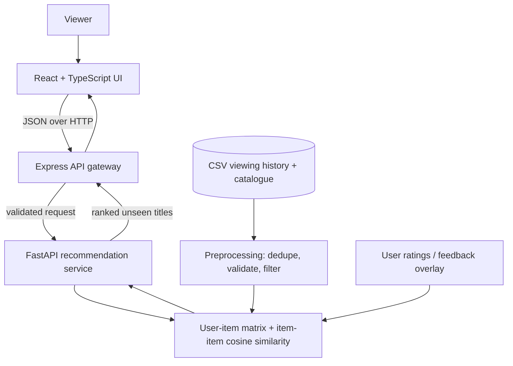

# StreamGen — personalized streaming discovery

StreamGen is a full-stack demo that recommends fictional movies and shows using **item-item collaborative filtering**. Users select titles from their viewing history, set 1–5 ratings, receive at least five unseen recommendations, and rate recommendations to influence later rankings.

## Features

- React + TypeScript responsive interface with viewing-history editor and recommendation cards.
- Express API gateway with input validation, rate limiting, security headers, and a short ML-service timeout.
- Python FastAPI recommendation service using pandas and scikit-learn cosine similarity.
- PostgreSQL persistence for feedback when run with Docker Compose; local manual mode can run without PostgreSQL.
- Preprocessing removes duplicate user/item events, invalid ratings, missing fields, blank users, and events for items not in the catalogue.
- 125 sample viewing-history interactions and 24 fictional catalogue titles.
- Feedback overlay updates a user's ratings and is included in the next recommendation request.
- Cold-start/popularity fallback, bounded request size, and clear API errors.

## Architecture



### Data flow

1. On startup, the ML service cleans `data/viewing_history.csv` and loads `data/catalog.csv`.
2. The viewer selects catalogue titles and assigns ratings in the UI.
3. The frontend posts `{ user_id, history, limit }` to the Express API, which validates basic shape and forwards the request to FastAPI.
4. The ML service builds a user-item matrix, computes item-item cosine similarities, scores unseen titles from the user's ratings, and applies a small popularity prior for sparse data.
5. The UI displays up to eight results (at least five when the catalogue has enough unseen titles).
6. A thumbs-up or thumbs-down submits a 5 or 1 rating. The feedback overlay is merged into the matrix and user's profile for subsequent recommendations.

## Run locally

Requirements: Node.js 20+, Python 3.11+, npm, and internet access for first-time package installation. In manual local mode, feedback is held in the ML process memory. Docker Compose includes PostgreSQL and persists feedback ratings across backend restarts.

### 1. Start the ML service

From the repository root:

```bash
cd ml-service
python -m venv .venv
# Windows PowerShell: .venv\Scripts\Activate.ps1
# macOS/Linux: source .venv/bin/activate
pip install -r requirements.txt
uvicorn app.main:app --reload --port 8001
```

### 2. Start the Express API

In a second terminal from the repository root:

```bash
cd backend
npm install
npm run dev
```

### 3. Start the React frontend

In a third terminal:

```bash
cd frontend
npm install
npm run dev
```

Open `http://localhost:5173`. API health checks: `http://localhost:4000/api/health` and `http://localhost:8001/health`.

### Optional Docker run

From the repository root, run `docker compose up --build`. This starts PostgreSQL, the backend, and ML service. For the frontend, run the local frontend steps above in a separate terminal. (The frontend development server calls the API at `http://localhost:4000/api` by default.)

## API

- `GET /api/health` — API and ML service status.
- `GET /api/catalog` — list of available titles.
- `POST /api/recommend` — body: `{"user_id":"you","history":[{"item_id":"m1","rating":5}],"limit":8}`. `limit` is between 5 and 20; history supports up to 100 entries.
- `POST /api/feedback` — body: `{"user_id":"you","item_id":"m10","rating":5}`. Ratings must be integers from 1 to 5.

FastAPI docs are available at `http://localhost:8001/docs`.

## Design choices and trade-offs

- **Item-item cosine similarity:** it is simple, interpretable, quick to compute for this small catalogue, and directly meets the collaborative-filtering requirement. A production system with a much larger catalogue would precompute similarities or use matrix factorization / approximate nearest neighbors.
- **CSV + in-memory feedback for a portable demo:** no database setup is needed to run the submission. The trade-off is that feedback resets on restart and the sample dataset is not intended for production. The Docker Compose setup persists feedback in PostgreSQL; the ML service keeps a fast in-memory overlay for the current process. A production deployment should also persist viewing events, handle schema migrations, and share/rebuild the feedback overlay across ML replicas.
- **Popularity fallback:** useful for sparse histories and cold-start cases, but less personalized than collaborative filtering. It is deliberately a small prior rather than the dominant score.
- **Synthetic fictional catalogue:** avoids third-party media API dependencies and makes the demo deterministic; artwork is generated with CSS rather than copyrighted poster assets.
- **Latency:** model computation is lightweight for this dataset and runs in-process; the API gateway times out after 2.5 seconds when calling the ML service. The under-3-second target should still be benchmarked in the actual target environment.

## Validation checklist

- [ ] Run `GET /health`; verify `clean_interactions` is at least 100.
- [ ] Submit a history of one to three titles; confirm at least five unseen recommendations appear.
- [ ] Rate a recommendation with thumbs-up/down, then refresh recommendations and compare ranking.
- [ ] Submit an invalid item ID or rating and confirm a helpful error response.
- [ ] Test 10 concurrent recommendation requests and record p95 latency before claiming the concurrency target.

## Demo video plan (under 8 minutes)

1. **0:00–0:40** — Introduce StreamGen and its goal.
2. **0:40–1:40** — Show the architecture diagram and stack.
3. **1:40–3:00** — Edit viewing history, change a rating, and request recommendations.
4. **3:00–4:00** — Rate one recommendation and refresh to demonstrate feedback.
5. **4:00–5:00** — Show `/health`, `/docs`, and the 125-row cleaned dataset.
6. **5:00–6:30** — Explain collaborative filtering, cold-start fallback, and trade-offs.
7. **6:30–7:30** — Walk through code structure and AI usage disclosure.

Keep the webcam on, share the actual running app and terminal/browser, and narrate in your own words. The generated source does not include a recorded video.

## AI usage

Disclose AI assistance accurately in your submission. Suggested starting point (edit to reflect your actual process):

> **AI tools used:** OpenAI ChatGPT was used to help scaffold the application structure, draft the collaborative-filtering implementation, write UI components and styling, and prepare initial README documentation. I reviewed and edited the generated code, checked the data cleaning and request-validation paths, and manually ran the application and requirement checklist before submission. Any claims about latency or concurrent users will be reported only after local testing. No AI-generated result is treated as a measured benchmark.

If you use other AI tools, add them here and describe which files or tasks they affected. Do not claim tests were passed unless you actually ran them.

## Repository structure

```text
streamgen/
├── backend/src/index.js          # Express API gateway + PostgreSQL feedback persistence
├── frontend/src/App.tsx          # React UI and feedback flow
├── frontend/src/styles.css       # Responsive visual design
├── ml-service/app/main.py        # preprocessing + collaborative filtering
├── data/catalog.csv              # fictional media catalogue
├── data/viewing_history.csv      # sample interactions (125 rows)
├── docker-compose.yml
└── README.md
```

## Before publishing

- Create a public GitHub repository and push this folder.
- Run the validation checklist and record actual results.
- Replace the AI usage draft with a truthful account of tools and verification.
- Record the narrated screen-share demo; keep it under 8 minutes and 200 MB.
