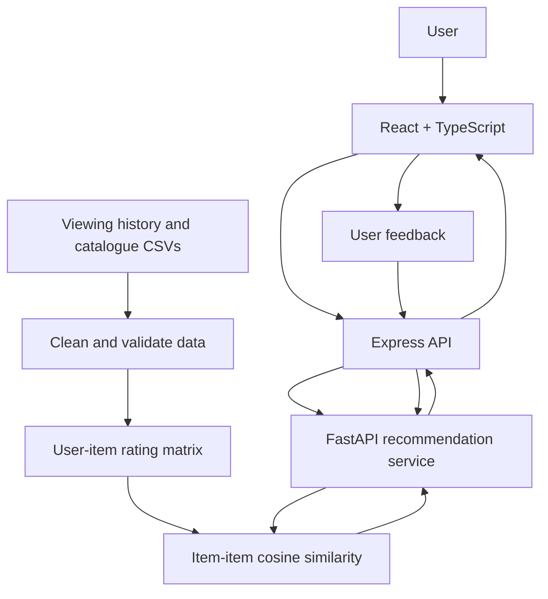

# StreamGen

StreamGen is a small movie and TV recommendation app I built to explore how viewing history can be used to suggest what someone might want to watch next. A user can select titles they have watched, rate them, and get a list of recommendations they have not seen yet.

The project uses a fictional catalogue and sample viewing data, so it can be run and tested without connecting to a real streaming service.

## Features

- Select titles and add them to a viewing history with ratings from 1 to 5.
- Generate recommendations based on patterns in user ratings.
- Rate recommendations and request an updated list.
- Clean the sample viewing history before using it.
- Check service status through health endpoints.

The sample dataset contains 125 viewing-history interactions across 24 catalogue titles. The app can return only titles that are present in the catalogue and have not already been watched by the user, so the number of results depends on the remaining titles.

## Tech stack

- **Frontend:** React, TypeScript, and Vite
- **Backend API:** Node.js and Express
- **Recommendation service:** Python, FastAPI, pandas, and scikit-learn
- **Data:** CSV files for the catalogue and viewing history
- **Feedback storage:** PostgreSQL in the Docker Compose setup

## How it works



At a high level, the frontend sends a user's viewing history to the Express API. The API forwards the request to the Python service, which prepares the data and calculates recommendations using item-item collaborative filtering and cosine similarity. The API returns the ranked results to the frontend. Feedback is included in later recommendation requests so it can affect subsequent suggestions.

Before calculating recommendations, the data-preparation step removes duplicate interactions and records with missing or invalid values, including ratings outside the accepted range and titles that are not in the catalogue.

## Run locally

### Requirements

- Node.js and npm
- Python 3.11 or newer
- Git (recommended)
- Docker Desktop only if you want to use the PostgreSQL-backed Docker setup

### 1. Start the recommendation service

From the project root, open a terminal and run:

```powershell
cd ml-service
python -m venv .venv
.venv\Scripts\Activate.ps1
pip install -r requirements.txt
uvicorn app.main:app --reload --port 8001
```

On macOS or Linux, activate the environment with:

```bash
source .venv/bin/activate
```

### 2. Start the Express API

Open a second terminal from the project root:

```powershell
cd backend
npm install
npm run dev
```

### 3. Start the frontend

Open a third terminal from the project root:

```powershell
cd frontend
npm install
npm run dev
```

Open the local URL printed by Vite. It is usually `http://localhost:5173`.

### Optional: run backend services with Docker Compose

If Docker Desktop is installed and running, use the project root:

```bash
docker compose up --build
```

Start the frontend separately using step 3. If you do not have Docker installed, use the local setup above.

## Useful URLs

- Frontend: `http://localhost:5173`
- Express API health: `http://localhost:4000/api/health`
- ML service health: `http://localhost:8001/health`
- ML API documentation: `http://localhost:8001/docs`

## API endpoints

| Method | Endpoint | Purpose |
| --- | --- | --- |
| `GET` | `/api/health` | Checks API status. |
| `GET` | `/api/catalog` | Returns catalogue titles. |
| `POST` | `/api/recommend` | Requests recommendations for a viewing history. |
| `POST` | `/api/feedback` | Submits a rating for a recommendation. |

Example recommendation request:

```json
{
  "user_id": "demo-user",
  "history": [
    { "item_id": "m1", "rating": 5 },
    { "item_id": "m2", "rating": 4 }
  ],
  "limit": 8
}
```

Use item IDs that exist in the catalogue. The API validates the request, and the number of recommendations is limited by how many unseen titles remain.

## Design decisions and trade-offs

**Item-item collaborative filtering.** I used cosine similarity to compare rating patterns between titles. It is relatively simple to implement and explain, and it fits this small dataset. A larger service would need more evaluation and might benefit from precomputed similarities or a different recommendation approach.

**CSV sample data.** CSV files make the sample easy to inspect and keep the project straightforward to set up. The trade-off is that the catalogue and viewing history are small and fictional, so they cannot demonstrate how well the system would perform with real users.

**Separate ML service.** Keeping the recommendation code in Python means I can use pandas and scikit-learn without mixing it into the Express API. The downside is that two backend services need to be started and monitored.

**New or sparse user histories.** When there is not much history to compare, collaborative filtering has less information to work with. The fallback recommendations help avoid returning an empty list, but they are less personalised.

**Persistence.** PostgreSQL is included in the Docker Compose setup for feedback storage. In a local setup without the database, feedback may be kept only in memory and can be lost when the service restarts. This would need to be addressed before using the app as a persistent multi-user service.

## Checks before submission

I use the following checklist to validate the project. Only mark a check complete after running it yourself and confirming the result.

- [ ] Start the services and confirm the health endpoints respond.
- [ ] Confirm the cleaned dataset contains at least 100 valid interactions.
- [ ] Submit a viewing history and confirm at least five unseen recommendations are returned when enough titles remain.
- [ ] Rate a recommendation, request recommendations again, and check whether the results change.
- [ ] Try empty history, unknown title IDs, and invalid ratings.
- [ ] Measure recommendation response time and check whether it is under three seconds.
- [ ] Test up to ten concurrent requests and record the observed response times.

Performance targets are goals to test, not results claimed by this README.

## Project structure

```text
streamgen/
├── backend/src/index.js
├── frontend/src/App.tsx
├── frontend/src/styles.css
├── ml-service/app/main.py
├── data/catalog.csv
├── data/viewing_history.csv
├── docker-compose.yml
└── README.md
```

## AI Usage:

I used OpenAI ChatGPT as a support tool while working on this project. It helped me think through the project structure, troubleshoot setup issues, review parts of the recommendation flow, and improve the documentation and interface wording. I ran the commands on my own machine and worked through the setup errors during development. I still need to verify the complete application flow and measure the performance targets before claiming that those checks pass.

I will update this section if I use any other AI tools and make sure the final description matches the assistance I actually used and the tests I personally completed.


